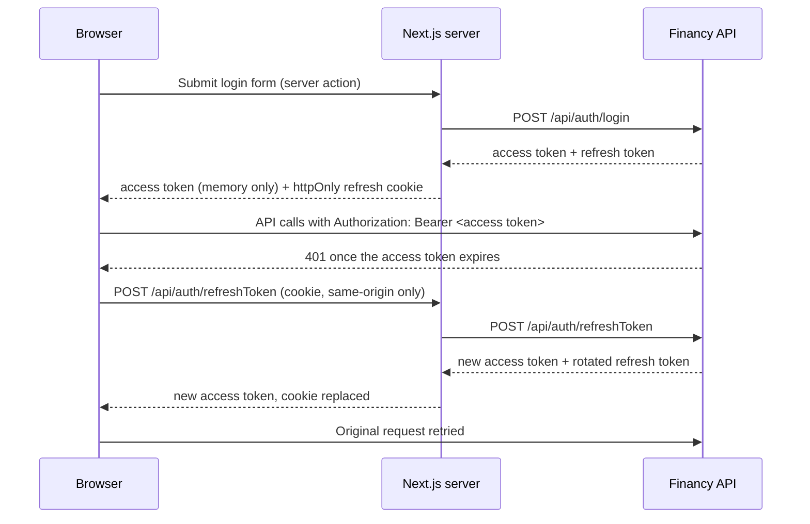

# Financy

Personal finance tracker: keep several accounts, record income and expenses, move money between accounts and see your balance at a glance.

Financy is a monorepo with an **ASP.NET Core 8 Web API** backend and a **Next.js 15** frontend. Account balances are never stored — they are computed in SQL from the transactions every time they are read.

> **Status:** work in progress. Authentication, accounts and the dashboard summary work end to end; transactions and transfers are available in the API but not yet in the UI. See [Project status](#project-status).

## Features

- **Sign up and sign in** with ASP.NET Core Identity. Short-lived JWT access tokens are kept in memory; rotating refresh tokens live in an `httpOnly` cookie.
- **Accounts** — create an account with a starting balance, list accounts with their current balance, delete an account (its transactions go with it).
- **Dashboard** — greeting, total balance across all accounts, and income and expense totals for a selected period (this month, last month, this year, last 12 months).
- **Transactions API** — create, edit, delete and filter income and expense transactions, fetch the latest N.
- **Transfers API** — move money between two of your own accounts in one atomic operation.

## Tech stack

| Area | Technologies |
| --- | --- |
| Backend | .NET 8, ASP.NET Core Web API, ASP.NET Core Identity, JWT Bearer authentication, Entity Framework Core 9, Swagger (Swashbuckle) |
| Database | SQL Server (LocalDB works for development) |
| Frontend | Next.js 15 (App Router), React 19, TypeScript, Tailwind CSS 4, SWR, axios, Zustand, Zod, React Hook Form, react-hot-toast |

## Architecture

```
Financy/
├── backend/                       .NET solution (Financy.sln)
│   ├── Financy.Domain/            Entities and enums: User, Account, Transaction, Category, RefreshToken
│   ├── Financy.Application/       DTOs, services (auth, JWT, accounts, transactions), repository interfaces
│   ├── Financy.Infrastructure/    AppDbContext, EF Core migrations, repositories, unit of work
│   └── Financy.API/               Controllers, exception middleware, Program.cs (DI, auth, CORS, Swagger)
└── frontend/                      Next.js app
    ├── app/
    │   ├── api/auth/              Route handlers for refresh and logout (own the refresh-token cookie)
    │   ├── login/, register/      Auth pages (server actions)
    │   ├── dashboard/             Dashboard page and cards
    │   ├── account/               Accounts page and modals
    │   ├── components/            Header, AuthBootstrap, shared UI
    │   ├── lib/                   API client, session handling, cookie options, CSP, Zod schemas
    │   └── store/                 Zustand store for the in-memory access token
    └── middleware.ts              Route protection and per-request Content-Security-Policy
```

The backend follows a layered (clean architecture) layout. Dependencies point inwards: `API → Infrastructure → Application → Domain`. Services in `Financy.Application` depend only on repository interfaces; `Financy.Infrastructure` implements them with EF Core.

### Authentication flow

The browser never sees the refresh token. Next.js server code owns it, and the browser only ever holds the short-lived access token in memory.



- **Access tokens** expire after `JwtSettings:ExpiryMinutes` (30 by default), with no clock skew allowed.
- **Refresh tokens** are random 32-byte values. The database stores only their SHA-256 hash. Every refresh rotates the token.
- **Reuse detection:** a rotated token is still accepted for 30 seconds, so parallel tabs can refresh at the same time. Reusing it after that window counts as a leak, and every session of that user is revoked.
- **Single in-flight refresh:** concurrent 401 responses in the browser wait for the same refresh request instead of racing each other.
- **Page reloads:** `AuthBootstrap` gets a fresh access token from the cookie before rendering protected pages.
- **Cookie:** named `refreshToken` in development and `__Host-refreshToken` in production (`Secure`, host-only). Its `SameSite` is `Lax` and it lasts 7 days.
- **Hardening:** a per-request CSP with a nonce (`middleware.ts`) and security headers (`next.config.ts`). The cookie-handling route handlers also reject cross-origin requests.

`middleware.ts` redirects to `/login` when there is no refresh cookie. This check is only a convenience: the API validates the token on every request.

### Balance model

```
balance = InitialBalance + Σ income − Σ expense
```

- Balances are calculated in SQL whenever they are read. The database has no balance column that could drift out of sync. An index on `(AccountId, Type)` keeps these queries fast.
- Negative balances (overdraft) are allowed.
- **A transfer is two linked rows** that share a `TransferGroupId`:
  - an `Outgoing` expense on the source account;
  - an `Incoming` income on the destination account.

  Both rows are saved in a single `SaveChanges`.
- A database check constraint keeps categories consistent: a regular transaction must have a category, and a transfer leg must not.

## Getting started

### Prerequisites

- [.NET 8 SDK](https://dotnet.microsoft.com/download) (a newer SDK works too, as long as the ASP.NET Core 8 runtime is installed)
- SQL Server — [LocalDB](https://learn.microsoft.com/sql/database-engine/configure-windows/sql-server-express-localdb) (installed with Visual Studio) or any other instance
- EF Core CLI tools, in the 9.x line to match EF Core 9: `dotnet tool install --global dotnet-ef --version "9.*"`
- [Node.js](https://nodejs.org/) **22.15 or newer** and npm (the dev scripts use `--use-system-ca`)

### 1. Backend

Run these commands from the `backend/` directory.

1. Create a local configuration file. `appsettings.json` is ignored by git.

   ```bash
   cp Financy.API/appsettings.example.json Financy.API/appsettings.json
   ```

2. In `Financy.API/appsettings.json`, replace `JwtSettings:SecretKey` with a random string of **at least 32 characters**. You can generate one with:

   ```bash
   openssl rand -base64 48
   ```

   If you use a database other than LocalDB, also change `ConnectionStrings:DefaultConnection`.

3. Create the database and apply all migrations:

   ```bash
   dotnet ef database update --project Financy.Infrastructure --startup-project Financy.API
   ```

4. Start the API:

   ```bash
   dotnet run --project Financy.API
   ```

The API listens on **http://localhost:5198**. Swagger UI is at **http://localhost:5198/swagger** (Development environment only). To call protected endpoints from Swagger, click **Authorize** and paste an access token from `POST /api/auth/login`.

### 2. Frontend

Run these commands from the `frontend/` directory.

1. Create a local environment file. The defaults point at the backend from step 1.

   ```bash
   cp .env.example .env.local
   ```

2. Install dependencies and start the dev server:

   ```bash
   npm install
   npm run dev
   ```

Open **http://localhost:3000**, register an account and sign in.

### Running over HTTPS (optional)

1. Trust the ASP.NET Core development certificate:

   ```bash
   dotnet dev-certs https --trust
   ```

2. Start the backend with the HTTPS profile. It listens on https://localhost:7211 (and http://localhost:5198).

   ```bash
   dotnet run --project Financy.API --launch-profile https
   ```

3. Point `API_URL` and `NEXT_PUBLIC_API_URL` in `frontend/.env.local` to `https://localhost:7211/api`.

4. Start the frontend with HTTPS:

   ```bash
   npm run https
   ```

   Next.js generates a self-signed certificate in `frontend/certificates/`, which git ignores.

The npm scripts set `NODE_OPTIONS=--use-system-ca`. With it, server-side `fetch` calls from Next.js trust the operating system's certificate store, which includes the ASP.NET Core development certificate.

## Configuration

### Backend — `backend/Financy.API/appsettings.json`

| Key | Description | Default in example |
| --- | --- | --- |
| `ConnectionStrings:DefaultConnection` | SQL Server connection string | LocalDB, database `financyDB` |
| `Cors:AllowedOrigins` | Origins allowed to call the API with credentials | `http(s)://localhost:3000` |
| `JwtSettings:SecretKey` | HMAC-SHA256 signing key, **at least 32 characters** | `CHANGE_ME` (must be replaced) |
| `JwtSettings:Issuer` / `Audience` | Expected token issuer and audience | `financy_app` / `financy_app_users` |
| `JwtSettings:ExpiryMinutes` | Access token lifetime | `30` |
| `JwtSettings:RefreshTokenExpiryDays` | Refresh token lifetime | `7` |

If `Cors:AllowedOrigins` is missing, the API allows `http://localhost:3000` and `https://localhost:3000`.

### Frontend — `frontend/.env.local`

| Variable | Used by | Example |
| --- | --- | --- |
| `API_URL` | Next.js server: login and register server actions, refresh and logout route handlers | `http://localhost:5198/api` |
| `NEXT_PUBLIC_API_URL` | Browser: axios client, also added to the CSP `connect-src` | `http://localhost:5198/api` |

The refresh cookie lifetime is set in `frontend/app/lib/authCookie.ts`. Keep it in sync with `JwtSettings:RefreshTokenExpiryDays`.

## Database and migrations

- Migrations live in `backend/Financy.Infrastructure/Migrations`. They are **not** applied on startup, so run `dotnet ef database update` after pulling changes that include new migrations.
- Add a migration from the `backend/` directory:

  ```bash
  dotnet ef migrations add <MigrationName> --project Financy.Infrastructure --startup-project Financy.API
  ```

- Categories are seeded with fixed IDs. There is no categories endpoint yet, so clients use these IDs directly:

  | ID | Category | ID | Category | ID | Category |
  | --- | --- | --- | --- | --- | --- |
  | 1 | Groceries | 5 | Entertainment | 9 | Travel |
  | 2 | House | 6 | Personal | 10 | Finances |
  | 3 | Food | 7 | Health care | 11 | Others |
  | 4 | Transport | 8 | Education | | |

## API reference

- All routes are prefixed with `/api`.
- 🔒 marks endpoints that need an `Authorization: Bearer <access token>` header.
- JSON uses camelCase. Dates use the `YYYY-MM-DD` format.
- Transaction `type` is a number: `0` = Income, `1` = Expense, `2` = Transfer.
- Errors thrown by services return `{ "StatusCode": <code>, "Message": "<text>" }` with status 400, 401, 403, 404 or 500.

### Auth — `/api/auth`

| Method | Route | Description |
| --- | --- | --- |
| `POST` | `/register` | Body `{ email, password, firstName }`. Returns 400 with a list of Identity errors when validation fails. |
| `POST` | `/login` | Body `{ email, password }`. Returns `{ accessToken, refreshToken }`. |
| `POST` | `/refreshToken` | Body: the refresh token as a JSON string. Returns a new token pair; the old refresh token stops working. |
| `POST` | `/logout` | Body: the refresh token as a JSON string. Revokes it. |
| `GET` 🔒 | `/name` | First name of the signed-in user. |

The password policy is the ASP.NET Core Identity default: at least 6 characters, with an uppercase letter, a lowercase letter, a digit and a special character.

### Accounts — `/api/account` 🔒

| Method | Route | Description |
| --- | --- | --- |
| `GET` | `/` | The user's accounts, each with `initialBalance` and computed `totalBalance`. |
| `POST` | `/` | Body `{ name, startingBalance }`. Creates an account. |
| `GET` | `/{id}` | One account, with its balance. |
| `DELETE` | `/{id}` | Deletes the account and all its transactions. |
| `GET` | `/balance` | Total balance across all of the user's accounts. |
| `GET` | `/{id}/balance` | Balance of one account. |

### Transactions — `/api/transaction` 🔒

| Method | Route | Description |
| --- | --- | --- |
| `GET` | `/` | All of the user's transactions, newest first. |
| `GET` | `/last?size=N` | The N most recent transactions. |
| `GET` | `/{id}` | One transaction. |
| `GET` | `/filter` | Query parameters, all optional: `minAmount`, `maxAmount`, `startDate`, `endDate`, `type`, `accountId`, `categoryId`. |
| `GET` | `/incomes?startDate=YYYY-MM-DD` | Sum of income since `startDate`. |
| `GET` | `/expenses?startDate=YYYY-MM-DD` | Sum of expenses since `startDate`. |
| `POST` | `/` | Body `{ amount, date?, description, type, accountId, categoryId }`. If `date` is omitted, today's date is used. |
| `POST` | `/transfer` | Body `{ sourceAccountId, destinationAccountId, amount, date?, description? }`. Returns the `transferGroupId`. |
| `PUT` | `/{id}` | Body `{ id, amount, date, description, categoryId }`. |
| `DELETE` | `/{id}` | Deletes a transaction. |

## Frontend scripts

Run from `frontend/`:

| Command | Description |
| --- | --- |
| `npm run dev` | Dev server with Turbopack on http://localhost:3000 |
| `npm run https` | Dev server over HTTPS with a self-signed certificate |
| `npm run build` | Production build |
| `npm run start` | Serve the production build |
| `npm run lint` | `next lint` (ESLint is not configured yet) |

## Project status

### Planned

- Dashboard modals for adding income, adding expenses and transferring money. The transfer card is disabled for now.
- New pages behind the existing menu links: **Transactions** (list with filters and pagination), **Analytics** and **Wallet**.
- More dashboard panels:
  - recent transactions;
  - spending by category;
  - change compared with the previous period;
  - a custom date range.
- Registration UX: password confirmation and live password requirement checks.
- Moving transaction filtering and totals into SQL, with pagination.
- Responsive layout on small screens.

### Known limitations

- The **Transactions**, **Analytics** and **Wallet** menu links lead to pages that don't exist yet (404).
- The dashboard income and expense totals have two problems:
  - The endpoints only use `startDate`, so the period's `endDate` is ignored.
  - Transfer legs are stored as income and expense rows, so transfers count towards these totals.
- `GET /transaction/filter`, `/incomes` and `/expenses` load all of the user's transactions into memory before filtering. There is no pagination.
- Editing a transaction can't change its type or account. Each transfer leg is edited or deleted on its own: changing one leg leaves the other unchanged.
- The **Add account** form requires a starting balance greater than 0. The API itself accepts any value, including negative ones.
- There are no automated tests yet.

## Troubleshooting

| Symptom | Likely cause |
| --- | --- |
| Login always reports *Invalid email or password* | The frontend shows this message for any login error. If `SecretKey` is shorter than 32 characters, the API answers login with 400 and `IDX10653` or `IDX10720`. Also check that the API is running and `API_URL` is correct. |
| *Could not connect to the server* after a page reload | The Next.js server can't reach the API at `API_URL`. Token refresh goes through Next.js, not the browser. |
| CORS errors in the browser console | Add the frontend origin to `Cors:AllowedOrigins`. |
| `npm run dev` fails with an error about `--use-system-ca` | Node.js is too old for this flag. Upgrade to 22.15 or newer. |
| `dotnet ef` cannot connect to `(localdb)\mssqllocaldb` | LocalDB isn't installed or started. Run `sqllocaldb info`, or point the connection string at another SQL Server instance. |
